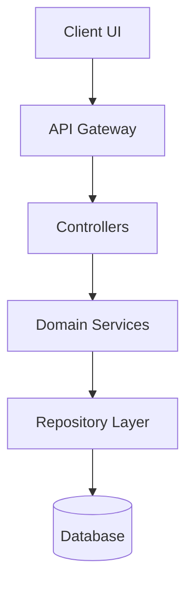

# Living Project Documentation, Domain Modeling & Obsidian Integration

Comprehensive runbook for maintaining synchronized project architecture documentation, ubiquitous domain models (`CONTEXT.md`), Architecture Decision Records (`docs/adr/`), open-source repository SEO/GEO metadata, and Obsidian vault bridges.

---

## 1. Documentation & Domain Structure

```
/
├── CONTEXT.md          # Ubiquitous domain language, bounded terms, and avoided synonyms
├── llms.txt            # Plain-text architectural summary for AI RAG parsers
└── docs/
    ├── overview.md     # High-level vision, stack, and environment setup
    ├── architecture.md # Layered system architecture & Mermaid diagrams
    ├── workflows.md    # Sequence flows & data contracts
    └── adr/            # Architecture Decision Records (e.g. 0001-slug.md)
```

In multi-context repositories, place a `CONTEXT-MAP.md` at root listing contexts and their boundaries (`src/ordering/CONTEXT.md`, `src/billing/CONTEXT.md`).

---

## 2. Domain Modeling & Ubiquitous Vocabulary

Actively sharpen domain terminology during system design:
1. **Challenge Fuzzy Language:** Propose precise canonical terms whenever vague or overloaded words (e.g. "item", "record", "data") appear.
2. **Eliminate Synonyms:** When multiple terms describe the same concept, select the best one and explicitly mark alternatives under `_Avoid_`. See [CONTEXT-FORMAT.md](CONTEXT-FORMAT.md).
3. **Keep Implementation Out:** `CONTEXT.md` is strictly a domain vocabulary model, never an implementation spec or database schema dump.
4. **Stress-Test Boundaries:** Probe edge cases with concrete scenarios to clarify entity boundaries. Cross-reference code identifiers with `CONTEXT.md`.

---

## 3. Architecture Decision Records (ADR)

Create `docs/adr/` lazily when the first significant architectural choice occurs. Use sequential numbering (`0001-slug.md`). See [ADR-FORMAT.md](ADR-FORMAT.md).

Offer ADRs sparingly. All three criteria must be met:
1. **Hard to reverse:** The cost of changing direction later is substantial.
2. **Surprising without context:** Future maintainers would question why an obvious alternative was rejected.
3. **Real trade-off:** Genuine competing alternatives existed and one was chosen for specific technical reasons.

Do not write ADRs for obvious, low-cost, or trivial technical choices.

---

## 4. Architecture Diagrams (Mermaid)

Use Mermaid for component topologies and sequence flows:



---

## 5. GitHub SEO & Generative Engine Optimization (GEO)

Optimize public repositories for search engines and AI citation models:
1. **Repository Formula:** `[brand]-[primary-keyword]-[benefit]` with concise 120-character tagline.
2. **Entity Definition:** The opening sentences of `README.md` must clearly state:
   `[Brand] is an open-source [Primary Keyword] built with [Framework] for [Audience] to solve [Problem].`
3. **Structured Metadata:** Include specification tables, 10-15 ecosystem topics, and `llms.txt` at the root.

---

## 6. Obsidian Vault Synchronization Bridge

To sync application docs to `D:/dev/obsidian/hola`:
1. **Project Hubs:** Maintain `projects/[project]/_[project].md`.
2. **Technical Guides:** Colocate domain cheat sheets in `areas/tech/[domain]/`.
3. **Frontmatter Integrity:** Enforce valid YAML `type`, `project`, and `tags` keys.

---

## 7. Verification & Testing

Validate documentation integrity, vocabulary alignment, and repository metadata:
1. **Glossary Alignment Check:** Scan codebase type definitions (`interfaces`, `enums`, `classes`) to verify type names match terms defined in `CONTEXT.md`.
2. **ADR Consistency Check:** Verify that new ADRs in `docs/adr/` do not contradict existing accepted ADRs without an explicit `Supersedes: ADR-NNNN` reference.
3. **Markdown & Link Linting:** Ensure all internal links (e.g. `[CONTEXT-FORMAT.md](CONTEXT-FORMAT.md)`) resolve without dead paths.
4. **Mermaid Rendering Check:** Validate Mermaid syntax with zero unquoted brackets.
5. **GitHub Metadata Verification:**
   ```bash
   pwsh -NoProfile -Command "gh repo view --json description,repositoryTopics"
   ```

---

## 8. Common Pitfalls & Negative Constraints

- **Never put implementation details in CONTEXT.md:** Keep definitions tight, defining what an entity is, not how it is stored or fetched.
- **Never create frivolous ADRs:** Avoid documenting low-impact, reversible choices.
- **Never allow undocumented terminology drift:** Update `CONTEXT.md` immediately when domain language is refined.
- **Never leave docs outdated:** Update `docs/` in the same commit as architectural changes.
- **Never commit secrets:** Keep credentials, tokens, and `.env` values out of markdown files.
