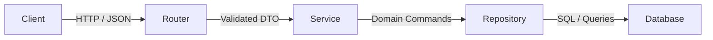
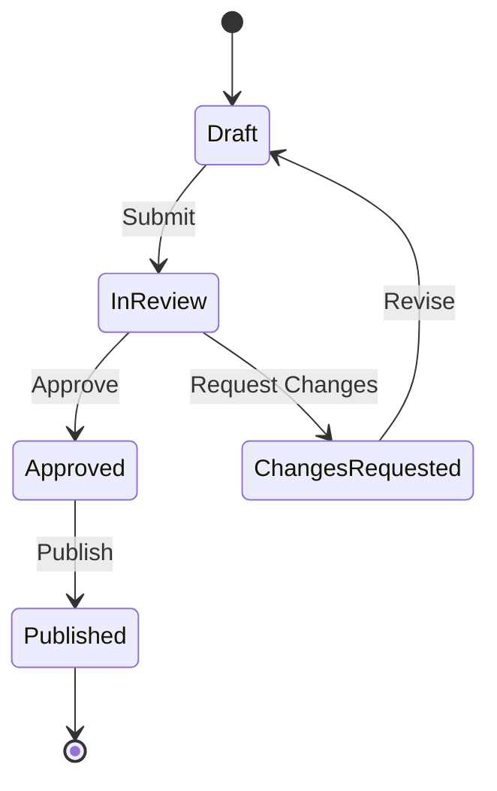

# To-Spec: RFC Architecture Specification Protocol

To-Spec synthesizes settled conversational design decisions, brainstorms, technical reviews, and local codebase inspections into a formal, unambiguous Request for Comments (RFC) engineering specification. It captures architectural contracts, invariants, and testable acceptance criteria without conducting redundant user interrogations.

```
[Settled Chat Decisions / ADRs / Code Inspection]
                        │
                        ▼
            [1. Context Synthesis]          ──► Zero re-interviewing; harvest existing facts
                        │
                        ▼
            [2. Boundary & State Modeling]  ──► Layered contracts, state machines, invariants
                        │
                        ▼
            [3. Acceptance Criteria]        ──► Formal Given-When-Then testable statements
                        │
                        ▼
            [4. RFC Specification Artifact] ──► Save to spec.md or project docs hub
```

---

## 1. Core Operating Principles

1. **Context Synthesis Without Redundant Interrogation:** Synthesize what has already been established in the conversation, codebase inspection, and existing ADRs. Never re-interview the user for settled decisions, known constraints, or existing file contents.
2. **Layered Clean Architecture Alignment:** Adhere strictly to Layered Clean Architecture (`Router / Controller -> Service -> Repository`). Services encapsulate business domain logic and return `Result<T, E>`. Edge validation occurs via Zod or Pydantic.
3. **Explicit State Machines & Invariants:** Reject ambiguous Boolean flags. Define explicit system states, valid transitions, and hard invariants.
4. **Given-When-Then Acceptance Criteria:** Every user-facing requirement must be written as a testable Given-When-Then scenario that maps directly to unit or integration test assertions.
5. **Enforce Non-Goals:** Every spec must declare explicit non-goals to prevent scope creep during subsequent ticket decomposition and implementation.

---

## 2. Specification Authoring Workflow

### Phase 1: Fact Harvesting
- Inspect the active conversation context, recent commit history, existing ADRs, and schema definitions.
- Extract locked decisions: chosen libraries, persistence patterns, route structures, and type contracts.
- Resolve any minor technical gaps using project standards and established design patterns rather than re-prompting the user.

### Phase 2: Architectural Contract Modeling
- Model data schemas and validation rules (Zod, Pydantic, or JSON Schema).
- Define service interfaces, function signatures, and error boundaries.
- Map state transitions using Mermaid state diagrams.

### Phase 3: Acceptance Criteria Formulation
- Write comprehensive Given-When-Then scenarios covering:
  - Happy path / golden flow
  - Validation failures and boundary limits
  - Network timeouts and external system degradation
  - Authorization / permission rejections

### Phase 4: Artifact Generation
- Output the specification artifact to `spec.md` in the current initiative directory or `<appDataDir>\brain\<conversation-id>/spec.md`.

---

## 3. Standard RFC Specification Template

Every generated specification must follow this structure:

```markdown
# RFC-[NNN]: [Feature / System Name]

**Status:** Draft | Under Review | Approved
**Author:** [Author / Agent]
**Date:** YYYY-MM-DD
**Initiative / Ticket:** [Initiative Reference]

---

## 1. Problem Statement
- **Background & Context:** What is the technical or business problem?
- **Core Tension:** Why does this problem require architectural change?
- **Quantifiable Goals:** Specific latency, throughput, error rate, or user experience targets.

---

## 2. Solution Overview
High-level summary of the proposed design and system boundaries.



---

## 3. Given-When-Then Acceptance Criteria

### Scenario 1: Successful Primary Flow (Golden Path)
- **Given:** A valid authenticated user with role `Editor`.
- **When:** Submitting a payload with valid `title` and `content`.
- **Then:** The record is persisted, status code `201 Created` is returned, and cache is invalidated.

### Scenario 2: Validation Failure
- **Given:** A payload with missing required field `title`.
- **When:** Request arrives at the API boundary.
- **Then:** Immediate `400 Bad Request` returned with Zod validation issues list; service layer is never invoked.

### Scenario 3: Concurrency Conflict
- **Given:** An existing resource version `v2`.
- **When:** A concurrent update is submitted with optimistic lock version `v1`.
- **Then:** `409 Conflict` returned with error code `VERSION_MISMATCH`.

---

## 4. Layered Architecture Contracts

### 4.1 Boundary Schemas & DTOs
```typescript
import { z } from "zod";

export const CreateItemSchema = z.object({
  title: z.string().min(1).max(255),
  tags: z.array(z.string()).default([]),
});

export type CreateItemDTO = z.infer<typeof CreateItemSchema>;
```

### 4.2 Service Layer Contract
```typescript
export interface ItemService {
  createItem(dto: CreateItemDTO): Promise<Result<Item, DomainError>>;
  getItemById(id: string): Promise<Result<Item, NotFoundError>>;
}
```

### 4.3 Repository Interface
```typescript
export interface ItemRepository {
  insert(item: ItemEntity): Promise<ItemEntity>;
  findById(id: string): Promise<ItemEntity | null>;
}
```

---

## 5. State Machine & Invariants



### Invariants:
1. An item cannot transition to `Published` without reaching `Approved`.
2. Items in `InReview` are read-only to non-admin roles.
3. Once in `Published` state, deletion is soft (archival flag only).

---

## 6. Error Boundaries & Fallback Strategies

| Error Type | Boundary Caught | HTTP Status | Client Response Shape | Recovery Action |
|---|---|---|---|---|
| Schema Validation | Router / Middleware | `400` | `{ error: "VALIDATION_FAILED", details: [...] }` | Correct input |
| Domain Invariant | Service Layer | `422` | `{ error: "INVALID_STATE_TRANSITION" }` | Re-fetch state |
| Upstream Timeout | Service Layer | `503` | `{ error: "UPSTREAM_UNAVAILABLE" }` | Exponential backoff |
| Uncaught Exception| Global Error Filter | `500` | `{ error: "INTERNAL_ERROR" }` | Alert Sentry |

---

## 7. Out of Scope & Non-Goals

1. **Non-Goal 1:** Real-time push notifications over WebSockets (deferred to subsequent RFC).
2. **Non-Goal 2:** Batch CSV bulk import capabilities.
3. **Non-Goal 3:** Custom role definitions beyond existing RBAC primitives.
```

---

## 4. Verification & Quality Gates

Before declaring the specification complete and handing off to `/to-tickets`:
- [ ] **Zero Unanswered Questions:** All design tensions resolved from context and ADRs.
- [ ] **Layered Contracts Complete:** Clear Router, Service, and Repository interfaces defined.
- [ ] **Acceptance Criteria Testable:** Every Given-When-Then scenario maps to concrete assertion steps.
- [ ] **Invariants Explicit:** State machines and data integrity rules clearly specified.
- [ ] **Non-Goals Listed:** Boundaries clearly demarcated to prevent scope creep.
- [ ] **Portability Maintained:** Zero personal workstation paths in the specification.
