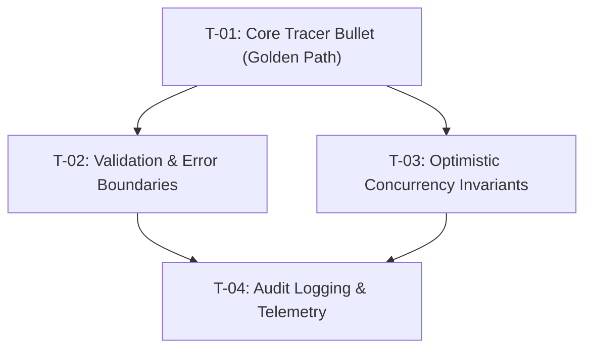

# To-Tickets: Vertical Tracer-Bullet Ticket Decomposition Protocol

To-Tickets decomposes formal engineering specifications (RFCs) into atomic, vertical-slice implementation tickets with strict dependency graphs (DAGs) and automated verification seams. It ensures that every ticket delivers verifiable user value, connects end-to-end layers, and is sized for single-session autonomous subagent execution.

```
[Approved RFC Specification (spec.md)]
                  │
                  ▼
   [1. Vertical Slicing Strategy]    ──► Reject horizontal layer silos
                  │
                  ▼
   [2. DAG Dependency Modeling]      ──► Determine parallel paths & blockers
                  │
                  ▼
   [3. Sizing for Single Agent Loop] ──► 1-3 files, 1 test suite per ticket
                  │
                  ▼
   [4. Ticket Generation]            ──► Output to .scratch/<feature>/tickets/
```

---

## 1. Core Operating Principles

1. **Strict Vertical Slices (Tracer Bullets):** Every ticket cuts across the full architectural layer stack (`Schema/Model -> Service Logic -> Router/UI -> Test Assertion`). Never create horizontal silo tickets (e.g., "Build DB Schema", "Write Router Endpoints", "Add Frontend UI" in separate tickets).
2. **Sized for Single Subagent Iterations:** Each ticket must be implementable and verifiable within a single subagent context run (e.g., Flash Implementer). Target 1 to 3 modified files and 1-2 test suites.
3. **Directed Acyclic Graph (DAG) Integrity:** Every ticket explicitly declares its prerequisites (`Blocked by: [ID]`). Tickets with no blockers can be executed concurrently in parallel subagents. Circular dependencies are strictly prohibited.
4. **Independent Verification Seams:** Each ticket must include a concrete, runnable test command (e.g., `npm test -- path/to/test.ts`) using the Arrange-Act-Assert (AAA) pattern.
5. **No Spec Drift:** Tickets must strictly reflect the approved RFC specification without injecting opportunistic scope or unplanned refactors.

---

## 2. Decomposition Workflow

### Phase 1: Tracer Bullet Identification
- Identify the golden path tracer bullet (the absolute minimum vertical slice that connects end-to-end user input to persistent storage and back).
- Make the tracer bullet Ticket #1. Subsequent tickets layer additional domain rules, validations, edge cases, and performance optimizations.

### Phase 2: Dependency DAG Construction
- Map out execution order.
- Group tickets into execution waves:
  - **Wave 1 (Tracer Bullet):** Core end-to-end path with primary test seam.
  - **Wave 2 (Parallel Slices):** Secondary scenarios, domain invariants, and error boundaries.
  - **Wave 3 (Hardening & Polish):** Edge caching, telemetry, and integration contracts.



### Phase 3: Ticket Authoring
- Output individual ticket Markdown files to `.scratch/<feature>/tickets/T-[NN]-[slug].md` or sync directly to active sprint files / issue trackers.

---

## 3. Atomic Ticket Schema

Every decomposed ticket must adhere to this exact structure:

```markdown
# [T-01]: [Action Verb + Domain Concept + Context]

**RFC Reference:** RFC-[NNN]
**Wave:** 1 | 2 | 3
**Blocked By:** None | T-00
**Files to Touch:**
- `src/domain/services/item-service.ts`
- `src/infrastructure/repositories/item-repository.ts`
- `tests/unit/item-service.spec.ts`

---

## 1. User Value & Context
One to two sentences explaining the end-to-end capability delivered by this slice.

---

## 2. Implementation Steps
1. **Repository Seam:** Implement repository query method with parameterized SQL.
2. **Service Domain Logic:** Implement business rule and error wrapping in `Result<T, E>`.
3. **API Boundary:** Wire controller endpoint with Zod schema validation.

---

## 3. Acceptance Criteria
- [ ] Valid requests persist the record and return `201 Created` with expected DTO.
- [ ] Schema validation errors return `400 Bad Request` with structured error details.
- [ ] Service returns typed domain error on invariant violation.

---

## 4. Verification Seam (Runnable Test)
Run the automated verification suite to prove the slice is complete:

```bash
# Execute unit and boundary tests for this ticket
npm test -- tests/unit/item-service.spec.ts
```

### AAA Test Template:
- **Arrange:** Instantiate service with mocked repository and valid DTO payload.
- **Act:** Invoke `itemService.createItem(dto)`.
- **Assert:** Verify `result.isOk()` is true, and repository `insert` was called exactly once.
```

---

## 4. Anti-Patterns & Negative Constraints

| Anti-Pattern | Why It Fails | Correct Pattern |
|---|---|---|
| **Horizontal Layering** | Ticket 1: DB Schema, Ticket 2: Controller. Nothing works until all tickets are done; debugging is delayed. | **Vertical Slicing:** Each ticket implements a thin end-to-end slice with automated tests. |
| **Monster Tickets** | A ticket touches 15 files and takes 5 agent turns. Agent loses context and introduces regressions. | **Atomic Sizing:** Split by scenario or state transition (1-3 files, 1 test file per ticket). |
| **Missing Verification Seam** | Ticket has vague acceptance criteria like "Works properly". | **Concrete Test Command:** Specific test file and assertion command included in every ticket. |
| **Circular Blockers** | Ticket A blocked by B; Ticket B blocked by A. | **DAG Validation:** Strict acyclic check before ticket release. |

---

## 5. Verification & Quality Gates

Before publishing tickets to the execution queue:
- [ ] **100% Spec Coverage:** Every acceptance criteria in `spec.md` is assigned to at least one ticket.
- [ ] **All Slices Vertical:** Zero horizontal pure-database or pure-UI tickets.
- [ ] **DAG is Acyclic:** Dependencies flow cleanly with no circular loops.
- [ ] **Wave 1 Has No Blockers:** At least one ticket can begin execution immediately.
- [ ] **Verification Command Present:** Every ticket includes an explicit test command.
- [ ] **Zero Hardcoded Personal Paths:** Portable across all developer machines and CI pipelines.
